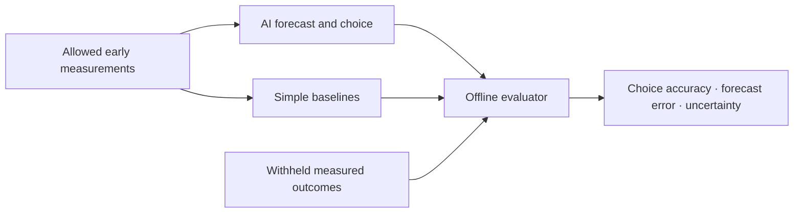
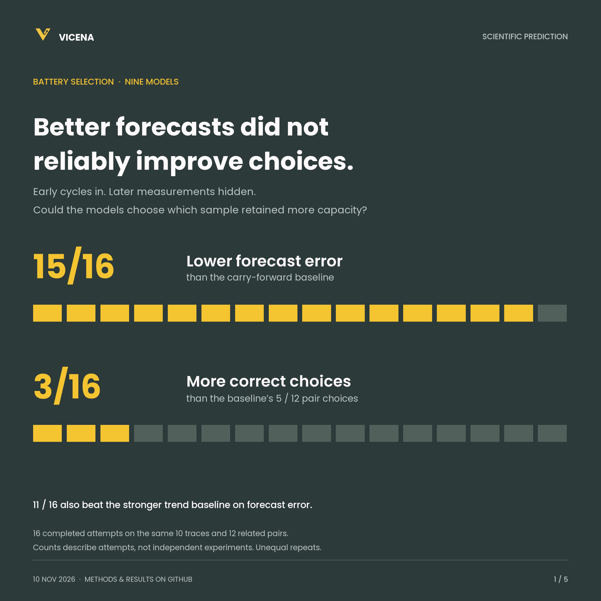

# Vicena Scientific Prediction Benchmark

**Can an AI turn early laboratory measurements into a useful prediction and a correct experimental choice?**

This pilot tests two concrete problems: predict later battery capacity from early cycling, and predict a later catalyst current from a partial electrochemical scan. Models return numerical forecasts and probabilities for choosing between records. We score both against withheld measurements and compare them with simple mathematical baselines.

**Public toolkit, private laboratory data.** This repository contains task definitions, a data dictionary, offline baselines and scoring, a software demo, and aggregate results. It contains no laboratory measurements, formulations, source files, answer keys, model predictions or raw session exports. Without the private case bundle, the reported experimental scores cannot be independently reproduced from this repository alone.

## The two tasks

| Task | Model sees | Model predicts | Why it matters |
| --- | --- | --- | --- |
| [Battery cycling](tasks/battery.md) | Nominal recipe/context and cycles 1–50 | Recorded capacity retention at cycles 351–360; which trace has higher retention | Separates estimating performance from choosing which candidate to advance |
| [Catalyst scan continuation](tasks/catalyst.md) | Current–potential observations through 0.600 V | Signed current at 0.800 V; which recording has higher current | Tests extrapolation and whether an early ordering survives later in a scan |

The battery target is a later recorded endpoint, not remaining useful life. The catalyst target is held back from the same scan, not a separate confirmatory assay. Neither task asks the model to discover a new formulation or prove a mechanism.



## Try the software

Requires Python 3.12 or later; the calculation code uses only the standard library.

```sh
git clone https://github.com/vicena-labs/scientific-prediction-benchmark.git
cd scientific-prediction-benchmark
PYTHONPATH=src python3 -m vicena_science_benchmark demo
PYTHONPATH=src python3 -m unittest discover -s tests -v
```

Or run `uv run --locked vicena-science-benchmark demo`.

The demo uses clearly labelled fabricated arithmetic controls. It makes no model calls, consumes no API credits and is not experimental evidence. For a private dataset, follow [the evaluation workflow](docs/reproduce.md). This tool does not launch models or enforce their filesystem/network isolation.

## Results: nine models, two scientific tasks

Updated 10 November 2026. The shared Python comparison has **30 completed attempts across nine models**, with later measurements hidden from every tested attempt. Forecasting improved more consistently than candidate selection.

| Task | Completed attempts | Lower forecast error than primary baseline | More correct choices than primary baseline |
| --- | ---: | ---: | ---: |
| Battery | 16 | 15/16 | 3/16 |
| Catalyst | 14 | 14/14 | 1/14 |

These fractions count **completed model attempts on reused records**, not independent experiments. Battery comparisons share 10 traces and catalyst comparisons share 8 scans. The primary baselines scored 5/12 battery choices and 5/7 catalyst choices. The stronger battery trend baseline also scored 5/12, and 11/16 attempts beat its forecast error.



The roster covers Astra, Sol 6.1 Pro, Luna, Fable 5.2, Opus 5.5, Grok 4.7, DeepSeek V4 Pro 0813, DeepSeek V4.1 Flash 1017 and GLM 5.3. Opus provider routes are reported separately in the full tables and combined descriptively in the summary bars. Attempts that did not produce a scorable answer are recorded as execution outcomes, never zero scientific scores. Repetitions are unequal and provider format adaptations are disclosed.

**Astra's battery choices were 6/12 and 4/12**, averaging the baseline's 5/12; its forecasts had lower error. The earlier native-notebook 3/12 result remains in the historical record but does not represent all Astra results. Separate subscription follow-ups show improvement with more early data, success with calibration-based cell selection, and successful interpretation of measured formulation performance. Those studies are not pooled with the multi-model comparison.

Read the [full multi-model results](docs/multi-model-results.md), [condition-block breakdown](docs/block-results.md), [assessment of strengths and gaps](docs/assessment.md), and [Astra follow-up task cards](tasks/followups.md). These are small retrospective development studies, not a general leaderboard or evidence that a model cannot do science. A wrong forecast alone does not prove that the correct answer was inferable from the supplied evidence.

## Figures

- [All-model battery comparison](figures/02-battery-models.png): supplier-grouped mean bars, observed run ranges and the stronger robust-trend baseline.
- [All-model catalyst comparison](figures/03-catalyst-models.png): the same metrics on a separate task and scale, against linear-tail extrapolation.
- [Astra with longer early-cycle prefixes](figures/04-astra-more-data.png): a separate subscription study.
- [Astra's cell-selection follow-up](figures/05-astra-selection.png): the effect of the revised method-assisted assignment on reused records.
- [Two-page square PDF](figures/Vicena_Scientific_Benchmark_Results.pdf) and [figure notes / editable SVGs](figures/README.md). The current PDF contains only the battery and catalyst bar charts; the Astra follow-ups above remain separate earlier figures.

## Explore

- [Scientific data dictionary](docs/sample-data-dictionary.md): data types, formats, scientific applications and ways to scope a dataset with Vicena.
- [Benchmark data dictionary](docs/data-dictionary.md): the exact battery/catalyst fields, units, missing values and evaluation schema.
- [Protocol](docs/protocol.md): cutoffs, hidden outcomes, metrics, baselines and comparison controls.
- [Run and reproduce](docs/reproduce.md): validate, package and score your own private cases.
- [Multi-model results](docs/multi-model-results.md), [scientific assessment](docs/assessment.md), and [earlier Astra results](docs/results.md).
- Machine-readable aggregates: [multi-model comparison](results/multi-model-summary.json), [Astra follow-ups](results/astra-followups.json), and [historical pilots](results/pilot-summary.json).
- [Contributing](CONTRIBUTING.md): propose a task or submit a reproducible run without exposing source records.

Maintained by [Vicena](https://vicena.ai). To discuss scientific datasets or a private evaluation, see [Vicena's experimental data programme](https://vicena.ai/experimental-data). Code is MIT licensed; private datasets are not included in that licence.
