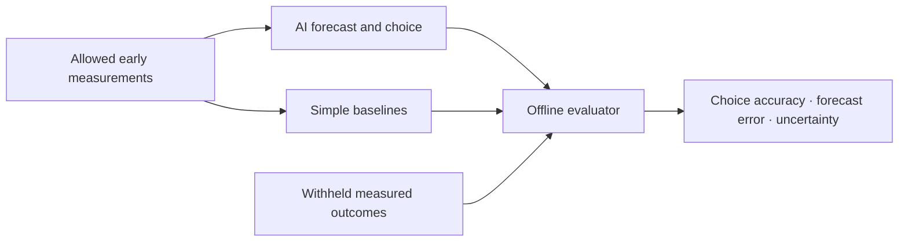

# Vicena Scientific Prediction Benchmark

**Can an AI turn early laboratory measurements into a useful prediction and a correct experimental choice?**

This pilot tests two concrete problems: predict later battery capacity from early cycling, and predict a later catalyst current from a partial electrochemical scan. Models return numerical forecasts and probabilities for choosing between records. We score both against withheld measurements and compare them with simple mathematical baselines.

**Public toolkit, private laboratory data.** This repository contains task definitions, a data dictionary, offline baselines and scoring, a software demo, and aggregate results. It contains no laboratory measurements, formulations, source files, answer keys, model predictions or raw session exports. Without the private case bundle, the reported experimental scores cannot be independently reproduced from this repository alone.

## The two tasks

| Task | Model sees | Model predicts | Why it matters |
| --- | --- | --- | --- |
| [Battery cycling](tasks/battery.md) | Nominal recipe/context and cycles 1–50 | Recorded capacity retention at cycles 351–360; which trace has higher retention | Separates estimating performance from choosing which candidate to advance |
| [Catalyst scan continuation](tasks/catalyst.md) | Current–potential observations through 0.600 V | Signed current at 0.800 V; which recording has higher current | Tests extrapolation and whether an early ordering survives later in a scan |

The battery target is a later recorded endpoint, not remaining useful life. The catalyst target is held back from the same scan, not a separate confirmatory assay. Neither task asks the model to discover a new formulation or prove a mechanism.



## Try the software

Requires Python 3.12 or later; the calculation code uses only the standard library.

```sh
git clone https://github.com/vicena-labs/scientific-prediction-benchmark.git
cd scientific-prediction-benchmark
PYTHONPATH=src python3 -m vicena_science_benchmark demo
PYTHONPATH=src python3 -m unittest discover -s tests -v
```

Or run `uv run --locked vicena-science-benchmark demo`.

The demo uses clearly labelled fabricated arithmetic controls. It makes no model calls, consumes no API credits and is not experimental evidence. For a private dataset, follow [the evaluation workflow](docs/reproduce.md). This tool does not launch models or enforce their filesystem/network isolation.

## Pilot findings

Latest completed setup: Astra through Vicena's native notebooks, High effort, one attempt per task on 9 November 2026.

| Task | Astra correct pair choices | Primary baseline | Astra mean forecast error | Primary baseline error |
| --- | ---: | ---: | ---: | ---: |
| Battery | 3/12 | 5/12 | 3.519 retention percentage points | 5.562 percentage points |
| Catalyst | 5/7 | 5/7 | 11.717 mA | 15.454 mA |

The stronger secondary battery baseline had error 3.313 percentage points, better than Astra. Forecast accuracy and choice accuracy can therefore tell different stories. The fractions count comparisons between records: twelve battery pairs share ten traces, and seven catalyst pairs share eight scans. They are not 19 independent experiments.

The model scope is **Astra, Sol and Luna**. Only Astra has completed this exact paired-outcome version. Sol and Luna have no scores on it yet; earlier tests using different questions are not pooled into this table. All three available Astra setups, including the earlier 6/12 battery result, are disclosed in [the result history](docs/results.md). These are small retrospective development runs, not a general leaderboard or evidence that one model cannot do science.

## Explore

- [Data dictionary](docs/data-dictionary.md): fields, units, missing values and experimental context.
- [Protocol](docs/protocol.md): cutoffs, hidden outcomes, metrics, baselines and comparison controls.
- [Run and reproduce](docs/reproduce.md): validate, package and score your own private cases.
- [Results and limitations](docs/results.md): complete paired-task pilot history and evidence boundaries.
- [Machine-readable aggregate results](results/pilot-summary.json).
- [Contributing](CONTRIBUTING.md): propose a task or submit a reproducible run without exposing source records.

Maintained by [Vicena](https://vicena.ai). To discuss scientific datasets or a private evaluation, see [Vicena's experimental data programme](https://vicena.ai/experimental-data). Code is MIT licensed; private datasets are not included in that licence.
